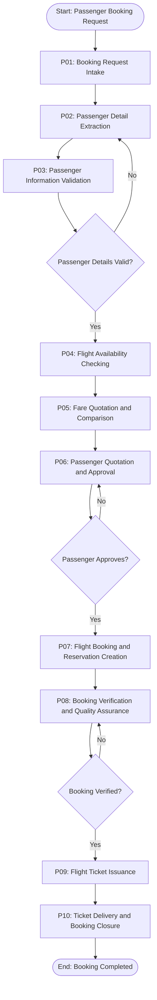

# AA Aviation Sdn Bhd – Flight Booking Workflow

## 1. Workflow Overview

This workflow demonstrates the proposed AI-assisted flight booking process for AA Aviation Sdn Bhd.

The process consists of ten stages, beginning with the passenger's booking request and ending with electronic ticket delivery and booking closure.

## 2. Workflow Diagram

## 3. Workflow Description

| Stage | Activity | Expected Output |
|---|---|---|
| P01 | Receive booking request | Booking request record |
| P02 | Extract passenger details | Passenger information |
| P03 | Validate passenger details | Validation report |
| P04 | Check flight availability | Available flight options |
| P05 | Compare flight fares | Fare quotation |
| P06 | Obtain passenger approval | Approval record |
| P07 | Create flight reservation | Booking reference (PNR) |
| P08 | Verify booking details | Verification report |
| P09 | Issue electronic ticket | Electronic ticket number |
| P10 | Deliver ticket and close booking | Completed booking record |

## 4. Human Oversight

Human supervision is required at important decision points, including:

- Passenger information verification.
- Confirmation of flight availability and fares.
- Passenger approval of the quotation.
- Reservation review.
- Payment verification.
- Final ticket issuance.
- Ticket delivery and booking closure.

## 5. Expected Outcome

The proposed workflow provides a structured approach to managing flight booking activities using AI-assisted administrative processes.

It aims to improve information consistency, reduce repetitive tasks and support employees throughout the booking process.

AI-generated information and booking records must be checked using authorised systems and approved by responsible personnel.
